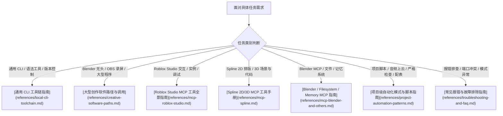

# 本机工具链与 MCP 全局使用指南 (Local Toolchain & MCP Guide)

本 Skill 是针对本机开发环境整理的**标准化、可移植的公共工具索引与使用指南**。
不仅包含各类命令行工具（CLI）、编译器/格式化工具、大型创意软件的绝对物理路径与无头调用范式，还全面覆盖了本机配置的各类 MCP（Model Context Protocol）工具集。

> [!TIP]
> **跨项目复用说明**：
> 本 Skill 采用模块化解耦设计。若其他项目需要使用，可直接将整目录 `.agents/skills/local-toolchain-mcp-guide/` 复制到目标项目的 `.agents/skills/` 下，或者复制到全局技能目录 `C:\Users\herong\.gemini\config\skills/`，即可开箱即用。

---

## 一、本机环境核心资产速查表 (Quick Reference)

| 类别 | 工具名称 | 物理路径 / 启动命令 | 主要用途 / 触发场景 |
| :--- | :--- | :--- | :--- |
| **Python 环境** | Python 3.13 | `C:\Users\herong\AppData\Local\miniconda3\python.exe` | 自动化脚本、离线回归、数据处理 |
| **Python 包管理**| uv / uvx | `C:\Users\herong\.local\bin\uv.exe` / `uvx.exe` | 极速拉取并无侵入运行 Python CLI / MCP 工具 |
| **Roblox 构建** | Rojo | `C:\Users\herong\.aftman\bin\rojo.exe` | Roblox 项目构建与文件同步服务 |
| **Luau 语言工具**| luau-lsp / Stylua | `C:\Users\herong\.aftman\bin\luau-lsp.exe` `C:\Users\herong\AppData\Roaming\npm\stylua.ps1` | Luau 严格类型分析、语法诊断与代码格式化 |
| **版本管理** | Git / TortoiseSVN | `C:\Program Files\Git\cmd\git.exe` `C:\Program Files\TortoiseSVN\bin\svn.exe` | 源码与美术资源版本控制 |
| **Node.js** | Node / npm | `C:\Program Files\nodejs\node.exe` | JS/TS 工具链运行与前端包管理 |
| **终端 Shell** | PowerShell 7 (pwsh) | `C:\Program Files\PowerShell\7\pwsh.exe` | 现代化跨平台命令行脚本执行 |
| **创意与建模** | Blender 5.4.0 | `D:\blender-5.4.0\blender-5.4.0\blender.exe` | 3D 建模、拓扑分析、Headless 无头 Python 渲染 |
| **视口与录制** | OBS Studio 64bit | `D:\obs-studio\bin\64bit\obs64.exe` | 游戏视口自动化校准、高帧率原尺寸录像与截屏 |
| **3D 协作设计** | Spline | `C:\Users\herong\AppData\Local\Programs\Spline\Spline.exe` | 实时 3D 协作、矢量排版与网页 3D 资产导出 |
| **Roblox 引擎** | Roblox Studio | `C:\Users\herong\AppData\Local\Roblox\Versions\version-63eb6055af4e4688\RobloxStudioBeta.exe` | Roblox 游戏主创环境与场景编辑 |
| **Roblox MCP** | Roblox_Studio MCP | `cmd.exe /c "%LOCALAPPDATA%\Roblox\mcp.bat"` | Studio 双向通信、实例树检索与调试执行 |
| **Spline MCP** | Spline MCP | `Spline.exe spline-mcp.cjs` (env: `ELECTRON_RUN_AS_NODE=1`) | Spline 2D/3D 画布控制、生成与代码运行 |
| **Blender MCP** | mcp-for-blender | `C:\Users\herong\.local\bin\uvx.exe mcp-for-blender` | Blender MCP 接口与脚本调用 |

---

## 二、任务路由与导航指南 (Task Decision Matrix)

根据当前面临的具体开发任务，按需查阅对应的专门指南：

### 1. 通用命令行与环境管理
👉 查阅 [通用 CLI 工具链指南](references/local-cli-toolchain.md)：
包含 Python、uv/uvx、Node/npm、Git、TortoiseSVN、PowerShell 7、Aftman、Rojo、Stylua、luau-lsp 等完整调用命令与常用参数。

### 2. 大型创意创作软件与无头调用
👉 查阅 [大型创作软件路径与调用](references/creative-software-paths.md)：
包含 Blender 5.4.0 无头脚本模式（`--background --python`）、OBS 64-bit 自动化录屏启动约束、Spline 与 Roblox Studio 安装细节。

### 3. Roblox Studio MCP 交互
👉 查阅 [Roblox Studio MCP 工具全景指南](references/mcp-roblox-studio.md)：
包含 27 个工具详细规范（会话管理、实例树搜索、Luau 执行、模拟输入、控制台日志、图像与网格生成等）、反向 WebSocket 守护架构及安全红线。

### 4. Spline 2D / 3D 创作 MCP
👉 查阅 [Spline 2D/3D MCP 工具手册](references/mcp-spline.md)：
包含 23 个 2D 工具（画板、矢量、生成、排版）与 22 个 3D 工具（场景分析、代码运行、无头生成、视角切换、HTML 导出）的完整调用参数。

### 5. Blender / 文件系统 / 记忆 MCP
👉 查阅 [Blender / Filesystem / Memory MCP 指南](references/mcp-blender-and-others.md)：
包含 `mcp-for-blender` 配置与用法、Filesystem MCP 14 项文件操作、Memory MCP 知识图谱检索。

### 6. 项目常用工作流自动化脚本
👉 查阅 [项目级自动化模式与脚本指南](references/project-automation-patterns.md)：
涵盖 Luau 严格模式一键检查（`check-strict.ps1`）、Roblox Open Cloud 音频上传与 Studio 模板自动部署、OBS 客户端视口自动化校准、Excel 转 JSON 配表工具。

### 7. 疑难排查与避坑大全
👉 查阅 [常见报错与故障排除指南](references/troubleshooting-and-faq.md)：
包含 13469 守护端口占用解决、4455 OBS WebSocket 鉴权、路径空格与引号转义、Roblox Edit vs Play 模式限制、模块假性报错处理等。

---

## 三、后续工具补充规范 (How to Extend)

当您在本机安装了新工具或接入了新 MCP，请按如下流程扩充本指南：
1. **新 CLI / 软件**：在 `references/local-cli-toolchain.md` 或 `references/creative-software-paths.md` 追加条目，登记绝对路径、验证命令和调用范式；
2. **新 MCP Server**：在 `references/` 下新增对应文档（或在既有文档中补充），并在 `SKILL.md` 的速查表与决策树中登记；
3. **新项目通用脚本**：在 `references/project-automation-patterns.md` 中记录通用命令行模式，确保参数解耦。
