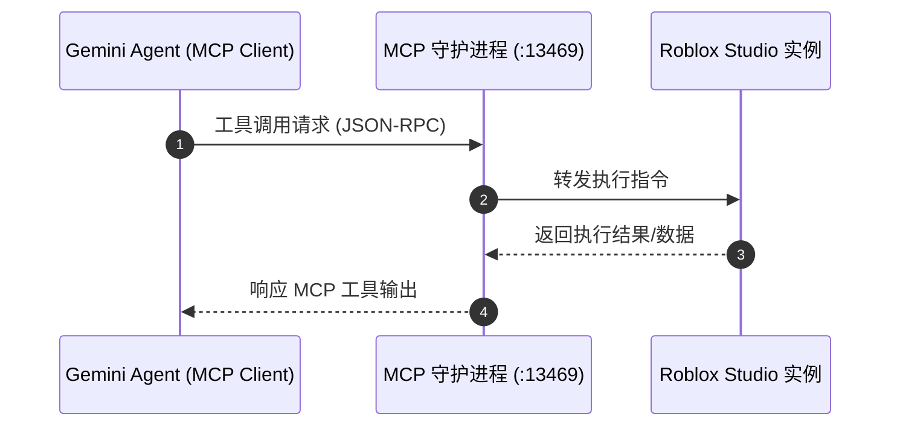

# Roblox Studio MCP 工具全景指南 (Roblox Studio MCP Reference)

Roblox Studio MCP 是实现 AI Agent 与运行中的 Roblox Studio 实例进行低延迟、双向交互的核心桥梁。
本机已配置完整的 27 个专用工具集，支持场景树检索、实例属性修改、代码无头运行、模拟键鼠输入、截图与 AI 资产生成。

---

## 一、MCP 服务架构与连接机制

### 1. 服务配置入口
- 配置文件位置：`C:\Users\herong\.gemini\config\mcp_config.json`
- 启动命令定义：
  ```json
  "Roblox_Studio": {
    "command": "cmd.exe",
    "args": [
      "/c",
      "\"%LOCALAPPDATA%\\Roblox\\mcp.bat\""
    ]
  }
  ```

### 2. 反向 WebSocket 守护架构
Roblox Studio MCP 采用毫秒级反向 WebSocket 守护架构：
- 守护服务默认监听：`http://127.0.0.1:13469/health` 与 `ws://127.0.0.1:13469/studio`
- Studio 启动后自动反向连入守护服务，建立双向控制信道。



---

## 二、27 个核心工具功能分类与详细指南

### 1. 会话发现与绑定 (Session & State)

#### `list_roblox_studios`
- **功能**：列出当前本机所有已打开并连接到 MCP 的 Roblox Studio 窗口与会话信息。
- **返回字段**：`studio_id`, `name`, `placeId`, `is_active`。
- **调用示例**：
  ```json
  {}
  ```

#### `set_active_studio`
- **功能**：设置当前操作的活跃目标 Studio 会话。
- **参数**：
  - `studio_id` (string, 必需): 目标 Studio 的唯一标识。
- **调用示例**：
  ```json
  { "studio_id": "studio_1" }
  ```

#### `get_studio_state`
- **功能**：获取指定或当前 Studio 的运行时状态。
- **返回**：当前运行模式（Edit、Play 或 Server）、相机位置、选择集等。

---

### 2. 场景树检索与实例探查 (Game Tree & Instances)

#### `search_game_tree`
- **功能**：通过关键词、类型或路径递归检索 DataModel 中的实例节点。
- **常用参数**：
  - `query` (string): 搜索关键词（如 `"Coin"`、`"Door"`）；
  - `datamodel_type` (string): `"Edit"` 或 `"Play"`；
  - `root_path` (string, 可选): 限制搜索根节点，例如 `"Workspace.Map"`。
- **调用示例**：
  ```json
  {
    "query": "CenterFrame",
    "datamodel_type": "Edit",
    "root_path": "ReplicatedStorage.UI"
  }
  ```

#### `inspect_instance`
- **功能**：获取指定实例的全部属性（Properties）、子节点列表（Children）及标签（Tags）。
- **常用参数**：
  - `instance_path` (string): 实例的层级路径，如 `"ReplicatedStorage.Sounds.Click"`；
  - `datamodel_type` (string): `"Edit"` 或 `"Play"`。

---

### 3. 代码执行与属性批量编辑 (Execution & Edit)

#### `execute_luau`
- **功能**：在 Studio 内动态执行 Luau 代码块，并捕获返回值与控制台输出。
- **参数**：
  - `code` (string): 需执行的 Luau 代码；
  - `datamodel_type` (string): 执行环境（`"Edit"` 模式只能进行配置与场景搭建；业务逻辑验证必须在 `"Play"` 模式）。
- **调用示例**：
  ```json
  {
    "code": "return game:GetService('Lighting').ClockTime",
    "datamodel_type": "Edit"
  }
  ```

#### `multi_edit`
- **功能**：事务性批量创建、更新或删除多个实例的属性，支持原子提交。
- **参数**：
  - `actions` (array): 包含创建、设置属性、设置父级的操作指令列表。

---

### 4. 运行控制与输入模拟 (Play & Input Simulation)

#### `start_stop_play`
- **功能**：启动或停止 Roblox Studio 的测试运行模式。
- **参数**：
  - `action` (string): `"start"`（进入 Play 模式）或 `"stop"`（停止并返回 Edit 模式）。

#### `user_keyboard_input`
- **功能**：模拟键盘按键输入（按下、抬起、敲击）。
- **参数**：
  - `key` (string): 键名（如 `"W"`, `"Space"`, `"Return"`）；
  - `action` (string): `"press"`, `"release"`, `"tap"`。

#### `user_mouse_input`
- **功能**：模拟鼠标指针移动与点击操作。
- **参数**：
  - `x` (number), `y` (number): 屏幕坐标；
  - `button` (string): `"Left"`, `"Right"`, `"Middle"`；
  - `action` (string): `"click"`, `"down"`, `"up"`, `"move"`.

#### `character_navigation`
- **功能**：控制角色移动到指定 3D 世界坐标或跟随特定目标实例。
- **参数**：
  - `target_position` (array): `[x, y, z]`；
  - `timeout_seconds` (number): 超时时间。

---

### 5. 控制台日志与视觉验收 (Logs & Screen Capture)

#### `get_console_output`
- **功能**：读取 Studio 输出窗口中的日志内容，支持过滤级别（Info、Warning、Error）。
- **参数**：
  - `max_lines` (number, 可选): 最大行数，默认 100；
  - `filter_type` (string, 可选): `"all"`, `"error"`, `"warning"`.

#### `screen_capture`
- **功能**：直接通过 Studio 内部渲染管线截取当前视口画面，返回图片临时路径或 Base64。
- **参数**：
  - `save_path` (string, 可选): 保存路径。

#### `wait_job_finished`
- **功能**：等待异步长时间任务（如大型网格导入或烘焙）完成。

---

### 6. 源码检索 (Script Search)

#### `script_read`
- **功能**：读取指定 Script / LocalScript / ModuleScript 的完整源码。
- **参数**：`instance_path` (string)。

#### `script_grep`
- **功能**：在全工程或指定分支的所有脚本源码中进行正则或文本模式检索。
- **参数**：
  - `pattern` (string): 检索字符串或正则表达式；
  - `root_path` (string, 可选): 起始根节点。

#### `script_search`
- **功能**：语义化检索相关的脚本内容。

---

### 7. 资产与 AI 模型/网格生成 (Assets & AI Generation)

#### `insert_asset`
- **功能**：根据 Roblox 资产 ID（`rbxassetid://...`）将模型、贴图或音频插入场景。
- **参数**：
  - `asset_id` (string): 资产 ID；
  - `parent_path` (string): 挂接的目标父节点。

#### `search_asset`
- **功能**：在 Creator Store / Toolbox 中检索符合条件的公开资产。
- **参数**：
  - `query` (string): 检索词。

#### `upload_image` / `store_image`
- **功能**：向 Studio 上传本地图像文件作为 Decal 或 Texture 资产。

#### `generate_mesh` / `generate_material` / `generate_procedural_model`
- **功能**：调用 Roblox Studio 内置 AI 生成能力，基于自然语言提示词生成 3D 几何网格、PBR 材质或程序化几何组件。

---

### 8. 辅助通信与扩展

#### `http_get`
- **功能**：通过 Studio 内部网络发起安全的只读 HTTP 请求。

#### `skill` / `subagent`
- **功能**：Studio MCP 内置的扩展与子代理委托原语。

---

## 三、工程红线与避坑规范 (Critical Rules)

> [!CAUTION]
> **1. 严禁在 Edit 模式下 require 业务模块**：
> 在 Edit 模式下执行 `require(ModuleScript)` 会触发 Roblox 引擎的模块隔离假性报错：
> `Module code did not return exactly one value`。
> **正确做法**：业务逻辑验证必须先调用 `start_stop_play(action='start')`，在 Play 环境下执行。
>
> **2. 严禁通过 execute_luau 覆写脚本源码**：
> 项目均采用本地代码文件 + Script Sync 机制同步至 Studio。禁止直接调用 MCP 修改 `Script.Source`，否则会引发草稿分叉和本地文件被反向覆盖。
>
> **3. 跨场景隔离原则**：
> 在执行任何写操作（UI 创建、模型放置）前，必须核验目标场景的 `placeId`，确保不会把大厅（Lobby）的资源写入游戏大逃杀（Game）场景。
