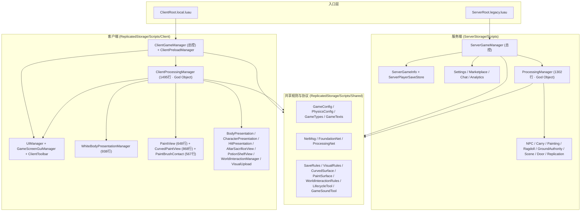
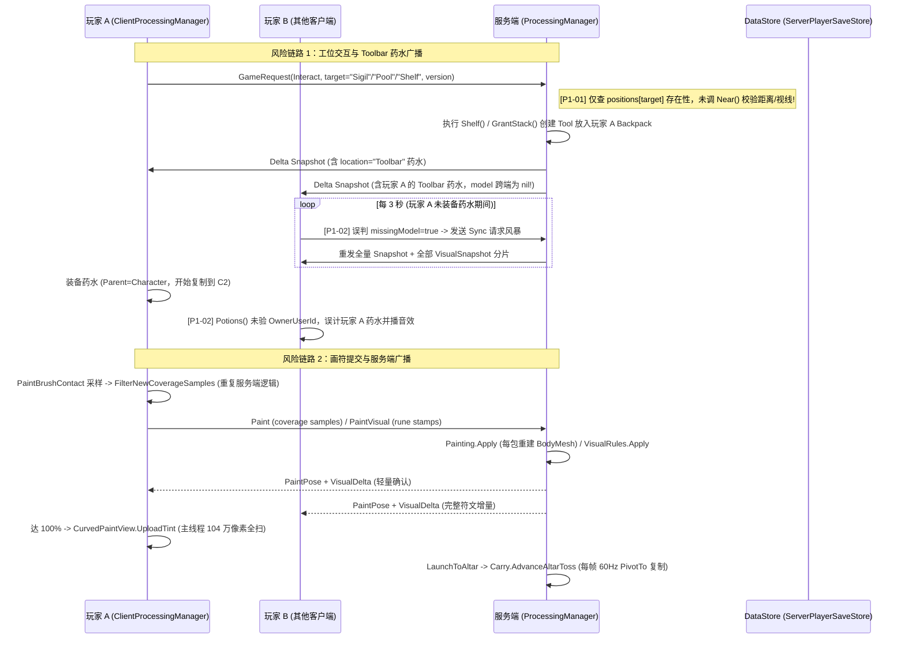

# 每周架构专项审查报告（2026-W47）

## 1. 审查概况

| 项目 | 内容 |
|---|---|
| 项目名称 | DemonShop（Roblox / Luau 共享合作布娃娃加工游戏） |
| 审查分支 | `main` |
| 审查类型 | **首次架构审查**（仓库无历史周报；已整合 2026-11-18 / 2026-11-19 每日扫描及 UI 审计记录） |
| BASE Commit | `7933d7ca7d28a583e74f0e582d130b1ede9b00cc`（2026-11-13，最早纳入提交的第一父提交） |
| HEAD Commit | `4086f7f14d93d37fb1e528b05e9a8cd14dd7fd75`（2026-11-20 17:49:19 +08:00） |
| 审查时间窗口 | 2026-11-14 04:00:02 ～ 2026-11-21 04:00:02（+08:00，过去 7 天） |
| 工作区状态 | 干净（排除所有未提交变更，仅审查 HEAD 已提交代码） |
| 提交统计 | 11 次线性提交（无合并提交），主要参与人：`Sixcube_Henry`（部分提交含 AI 协作签名） |
| 总变更规模 | 340 个文件变更（新增 256 / 修改 27 / 删除 57 / 重命名 0），总计 `+98,986 / -9,216` 行 |
| 业务脚本规模 | `Scripts/` 下 139 个文件变更（含移除 57 个旧农场脚本、新增/修改 82 个有效脚本），`+15,269 / -9,213` 行 |
| 高频修改模块 | `test_rules.py`（11 次）、`GameConfig.luau`（11 次）、`GameTypes.luau`（9 次）、`ClientProcessingManager.luau`（9 次）、`ProcessingManager.luau`（8 次）、`GameTexts.luau`（7 次）、`BodyPresentation.luau`（6 次）、`CurvedPaintView.luau` / `PaintView.luau` / `Painting.luau`（各 5 次） |
| 涉及核心子系统 | 基础框架（存档租约/资料/设置/商城/统计/UI 基类）、核心加工业务（街道击晕/堆叠肩扛/存放池/曲面画符/祭坛转化/药水架与法阵结算）、客户端白膜物理表现与预加载、世界交互与音频系统 |

### 本周提交脉络

1. `fec91f05`（11-17）：迁移 DemonShop 新架构，移除旧 Chicken/Farm 业务，引入画符、搬运与白膜展示。
2. `0f2dae29` / `b29d8647` / `4a1ede92`（11-17）：恢复基础框架原生 `PlayerInfo`/资料/设置/商城/统计/UI 契约，模块化拆分 UI 管理器与加工文本系统。
3. `8eedd5de`（11-18）：接入原生 `ProximityPrompt` 世界交互系统、命中反馈与 `ClientToolbar`。
4. `cc528846` / `50845080` / `7e982ff9`（11-19）：白膜客户端主导物理表现与预加载、音效系统与声学资产接入、多身体堆叠搬运与祭坛/药水架完整链路。
5. `b432fdfa` / `ecf12ae5` / `4086f7f1`（11-20）：双轴旋转椭圆体画笔与横截面采样、曲面 AI 符文等距贴印与高亮反馈、绘画台默认躺平锚定（关闭旋转/物理开关）及客户端确定性祭坛抛物线。

---

## 2. 执行摘要

本周完成了 DemonShop 从旧项目骨架到完整可玩加工闭环的首次架构成型。**架构亮点**在于：三层目录依赖边界清晰（全量扫描 271 条 `require` 边实现 **0 跨层依赖**）、基础框架 245 项契约与 DataStore 租约机制（`ServerPlayerSaveStore` + `PlayerSaveLeaseRules`）设计严谨、`ProcessingNet.Validate` 协议校验完备，且 109 个 `--!strict` 文件中业务脚本保持 **0 类型错误**。

但伴随 4 天内高密度功能叠加（11 次提交、净增 1.5 万余行脚本），系统已暴露出 **4 项已确认 P1 级高风险问题** 与 **9 项 P2 级架构/性能/一致性债务**：

- **安全与权威防线缺口（P1）**：`ProcessingManager:OnRequest` 对 5 大共享工位（Pool/Table/Altar/Shelf/Sigil）缺失距离与视线校验（2026-11-19 扫描发现后仅修复了地面拾取，遗漏工位分支），任意客户端可全图远程操作工位与提交药水刷金币。
- **多人状态与生命周期缺陷（P1 × 2）**：
  1. `Snapshot()` 向全服广播 `location == "Toolbar"` 的玩家私有用具，导致非持有客户端因无法复制他人 `Backpack` 而每 3 秒触发一次全服 `Sync` + 全量 `VisualSnapshot` 风暴；且他人装备药水后会被本地 `ClientProcessingManager:Potions()` 误计为自己的库存。
  2. 玩家死亡/重生时 `RescuePotions` 仅抢救已装备的药水而遗漏 `Backpack` 内未装备药水；旧 `Backpack` 销毁后 `self.items` 残留僵尸引用，导致该玩家下次从药水架领同品质药水时在 `GrantStack` -> `tool.Parent = backpack` 触发 `Parent is locked` 运行时崩溃并永久无法再领该品质药水。
- **回归门禁失效（P1）**：`4086f7f1` 将 `GameConfig.PaintTarget` 从 `0.7` 改为 `0.4` 但未同步更新 `test_visual_sync.luau:25`，导致主离线门禁 `python Tools/Gameplay/test_rules.py` 中断退出，直接跳过了下游 12+ 项核心测试。
- **架构膨胀与性能热点（P2）**：`ClientProcessingManager`（1,495 行）与 `ProcessingManager`（1,302 行）已演变为高频变更 God Object 并出现跨端覆盖计算重复与文件内拷贝代码；服务端祭坛抛掷仍每帧 60Hz `PivotTo` 复制（与客户端确定性抛物线重复）；`CurvedPaintView.UploadTint` 在主线程同步扫描 1024×1024（104 万像素）并上传 4MB 纹理；`build-game-assets.luau` 仍会破坏性删除基础框架远程事件与 UI。

**架构健康度总分：61 / 100（架构问题较多，受已确认 P1 上限 ≤69 约束）**。

**本周治理重点**：立即封堵 5 大工位服务端距离校验、修复 Toolbar 药水所有权隔离与重生防崩溃、恢复 `test_rules.py` 门禁全绿，随后按阶段拆分双端总控并治理高频渲染/网络开销。

---

## 3. 架构健康度

| 评估维度 | 满分 | 本周得分 | 上周得分 | 变化 | 评价 |
|---|---:|---:|---:|---:|---|
| 功能正确性与稳定性 | 25 | 15 | — | 首次审查 | 存在多人药水同步错乱（P1）、重生药水丢失与领药崩溃（P1）及 `AltarLoop` 音效无法循环（P2） |
| 架构合理性与可扩展性 | 25 | 17 | — | 首次审查 | 分层无跨层违例、基础契约稳固；但双端加工管理器演变为 God Object、规则跨端重复、构建脚本破坏基础资源 |
| 可维护性与代码质量 | 15 | 10 | — | 首次审查 | 存在文件内代码拷贝、死字段、模块级全局可变状态及临时扫描快照入库 |
| 性能与资源管理 | 15 | 9 | — | 首次审查 | 曲面染色全图 104 万像素主线程扫描、60Hz 冗余 `PivotTo`/交互重建、重生连接泄漏与 O(N×M) 临时约束 |
| 安全与数据一致性 | 15 | 8 | — | 首次审查 | 存档租约与协议校验扎实，但 5 大工位全图远程交互漏洞（P1）直接击穿服务端空间权威边界 |
| 测试与工程规范 | 5 | 2 | — | 首次审查 | 离线测试资产丰富，但主门禁 `test_rules.py` 在 HEAD 中断、缺多人边界用例、共享库 `TeleportTool` 存在既有 strict 报错 |
| **综合总分** | **100** | **61** | **—** | **首次审查** | **等级：60–69（架构问题较多）；存在 4 项已确认 P1，按规则总分上限 ≤69** |

- **评分状态**：正式（覆盖全部核心服务端/共享/客户端业务链路及 58 个关键文件，核心模块均已完成静态深度审查；Studio 实机帧率与多人真实网络表现列为待验证项，未做未经实测的数值宣称）。
- **对比说明**：本周为 DemonShop 首次每周架构审查，无上周周报可比基线。

---

## 4. 系统架构分析

### 4.1 整体分层与模块职责

项目遵循 `ServerRoot -> ServerGameManager` 与 `ClientRoot -> ClientGameManager` 双端唯一总控装配模型，业务代码清晰划分为三层，全量扫描 271 条 `require` 依赖边确认 **0 跨层反向依赖**：



### 4.2 关键业务链路与数据流风险

以本周最高风险的两条核心链路——**共享工位与药水结算链路** 及 **双端画符同步链路**——为例：



### 4.3 架构退化评估

1. **核心管理器职责失控（严重退化信号）**：最近 4 天内，`ClientProcessingManager.luau` 膨胀至 **1,495 行**（62 个实例字段、28 个依赖、5 个独立的 `RunService` 帧循环绑定，被 9/11 次提交触及）；`ProcessingManager.luau` 膨胀至 **1,302 行**（被 8/11 次提交触及）。几乎每次新增业务特性（堆叠搬运、音效、世界交互、祭坛抛物线、曲面符文）都在直接向这两个文件追加分支与状态字段，已形成显著的“修改热点聚集”。
2. **双端逻辑分叉与开关残留**：`4086f7f1` 关闭了 `PaintRotationEnabled` 与 `PaintPhysicsEnabled`，但相关的双轴旋转、椭圆体约束、零重力甩动物理与横截面切片代码仍完整驻留于热路径和协议层，增加了状态组合复杂度（例如 `ClientProcessingManager` 中近 200 行鼠标重定向/旋转逻辑与 `Painting.luau` 中的 `slice` 路径）。
3. **资产构建管线与运行契约漂移**：基础框架在 `0f2dae29` 恢复后，旧的 `Tools/Gameplay/build-game-assets.luau` 未同步收口，导致“重建脚本”与“运行契约”直接对立。

---

## 5. 重点问题与风险

### P1 — 高风险核心业务/安全/门禁缺陷

#### ARCH-2026W47-01：服务端 5 大工位 `Interact` 缺失距离与视线权威校验（全图远程操作与刷币）
- **严重程度 / 置信度 / 状态**：`P1` / `High` / `PERSISTING`（2026-11-19 扫描仅修复地面拾取，遗漏工位）
- **位置**：[ProcessingManager.luau](file:///c:/Users/herong/Desktop/work/DemonShop/Scripts/ServerStorage/Scripts/ProcessingManager.luau#L987-L1011)
- **相关 Commit**：`8eedd5de`（移除校验）、`cc528846`（仅补回地面拾取）、`4086f7f1`（HEAD 仍存在）
- **代码证据**：
  ```lua
  -- ProcessingManager.luau:995-1011
  local position = positions[target]
  if position then
      if request.version ~= self.stationVersions[target] then
          self:Tell(player, "StationChanged")
          return
      end
      -- 缺失: if not self:Near(player, position, Config.InteractionRange, nil) then ... end
      if target == "Pool" then self:Pool(player)
      elseif target == "Table" then self:Table(player) ...
  ```
- **触发场景**：任意存活玩家在地图任意位置（如街道远处或隔墙）构造合法 `GameRequest { action = "Interact", target = "Pool"|"Table"|"Altar"|"Shelf"|"Sigil", version = ... }`。
- **根本原因**：`8eedd5de` 切换至客户端原生 `ProximityPrompt` 后误删服务端空间校验；`cc528846` 仅恢复了 `else` 分支的地面物品 `self:Near` 检查（L1023），遗漏了 `if position then` 对应的 5 大工位分支，`position` 变量沦为死值。
- **实际影响**：客户端可全图远程存取存放池、远程抢占并锁定全服唯一绘画台、远程祭坛投尸、远程扫空药水架及远程提交药水为全服刷金币，彻底破坏服务端空间权威。
- **修复建议**：在 L1000 之后立即恢复 `if not self:Near(player, position, Config.InteractionRange, nil) then self:Tell(player, "StationTooFar"); return end`（可按实际交互范围加合理延迟余量，并保留 `Scene.Visible` 视线校验或可配置开关）。
- **验收标准**：新增管理器级回归测试，验证距 5 个工位均超过 `InteractionRange` 或被墙遮挡时请求全部被拒且返回 `StationTooFar`，近距离无遮挡正常通过。

#### ARCH-2026W47-02：全服广播 `Toolbar` 药水引发跨客户端 3 秒 `Sync` 风暴与库存/提示污染
- **严重程度 / 置信度 / 状态**：`P1` / `High` / `NEW`
- **位置**：[ProcessingManager.luau](file:///c:/Users/herong/Desktop/work/DemonShop/Scripts/ServerStorage/Scripts/ProcessingManager.luau#L123-L149)、[ClientProcessingManager.luau](file:///c:/Users/herong/Desktop/work/DemonShop/Scripts/ReplicatedStorage/Scripts/Client/ClientProcessingManager.luau#L233-L247)、[ClientProcessingManager.luau](file:///c:/Users/herong/Desktop/work/DemonShop/Scripts/ReplicatedStorage/Scripts/Client/ClientProcessingManager.luau#L1055-L1062)
- **相关 Commit**：`7e982ff9`
- **代码证据**：
  ```lua
  -- ProcessingManager.luau:123-124（仅跳过 Shelf，未跳过其他玩家私有的 Toolbar 药水，且 ItemView 未携带 owner）
  for _, item in self.items do
      if item.location == "Shelf" then continue end
      table.insert(list, { id = item.id, kind = item.kind, ..., location = item.location, model = item.model, ... })
  end
  -- ClientProcessingManager.luau:1056-1062
  for _, item in self.items do
      if not item.model or not item.model.Parent then missingModel = true; break end
  end
  if (not self.synced or missingModel) and now - self.lastSync > 3 ... then
      Net.FireRequest({ action = "Sync" })
  ```
- **触发场景**：2 名及以上玩家同服游玩；玩家 B 从药水架领取药水并放在 `Backpack`（未装备）或装备在手上。
- **根本原因**：Roblox 引擎不会将玩家 B 的 `Backpack` 复制给玩家 A。`Snapshot()` 将 `location == "Toolbar"` 的药水无差别全服广播，导致：
  1. 玩家 B 药水在 `Backpack` 时，玩家 A 收到的 `item.model` 为 `nil`，永久命中 `missingModel == true`，每 3 秒触发一次全量 `Sync`（含全服所有画符身体的 `VisualSnapshot` 分片重发）。
  2. 玩家 B 装备药水至 `Character` 后 `item.model` 复制到玩家 A，而 `ClientProcessingManager:Potions()`（L237-245）未校验 `OwnerUserId == player.UserId`，直接将玩家 B 的药水计入玩家 A 的 `stored` 数量，错误触发玩家 A 的 `PotionPickup` 音效与引导提示。
- **实际影响**：多人对局中持续触发高频全服重同步网络与序列化风暴，且本地 HUD/提示/交互状态出现跨玩家串台。
- **修复建议**：
  1. 服务端 `Snapshot()` 直接过滤 `item.location == "Toolbar"`（或仅在 `ItemView` 不广播他人私有 `Toolbar` 项），本地 `ClientProcessingManager:Potions()` 直接扫描 `player.Backpack` 与 `player.Character` 中的 `Potion` Tool（与 `ClientToolbar.luau` 保持单一事实来源）。
  2. 在 `ClientProcessingManager.Update` 中对 `missingModel` 仅检查世界实体（排除 `Toolbar`/`Shelf`）。
- **验收标准**：双客户端模拟测试中，玩家 B 领取/切换/装备药水后，玩家 A 不再触发 `Sync` 轮询且 `Potions()` 保持 `{ stored = 0, equipped = false }`。

#### ARCH-2026W47-03：玩家死亡重生未保护 `Backpack` 内药水，导致药水丢失且后续领药水抛出未捕获异常
- **严重程度 / 置信度 / 状态**：`P1` / `High` / `NEW`
- **位置**：[ProcessingManager.luau](file:///c:/Users/herong/Desktop/work/DemonShop/Scripts/ServerStorage/Scripts/ProcessingManager.luau#L543-L559)、[ProcessingManager.luau](file:///c:/Users/herong/Desktop/work/DemonShop/Scripts/ServerStorage/Scripts/ProcessingManager.luau#L628-L641)、[ProcessingManager.luau](file:///c:/Users/herong/Desktop/work/DemonShop/Scripts/ServerStorage/Scripts/ProcessingManager.luau#L683-L693)
- **相关 Commit**：`7e982ff9`
- **代码证据**：
  ```lua
  -- ProcessingManager.luau:636-640（仅抢救 Character 内已装备药水，遗漏 Backpack！）
  for _, child in character:GetChildren() do
      if child:IsA("Tool") and child.Name == "Potion" then child.Parent = reserve end
  end
  -- ProcessingManager.luau:544-559 & 687-688
  local existing = self:OwnedPotion(player, quality) -- 未检查 existing.model.Parent ~= nil
  ...
  if tool.Parent ~= backpack and tool.Parent ~= character then
      tool.Parent = backpack -- 对已被重生销毁的 Tool 设 Parent 抛出 "Parent property is locked"!
  end
  ```
- **触发场景**：玩家从药水架领取药水后切回木棒（药水进入 `Backpack`），随后角色死亡或重置重生，再次前往药水架领取同品质药水。
- **根本原因**：Roblox 角色重生时会销毁旧 `Backpack` 及其全部子 `Tool`（锁定 `Parent = nil`）。`RescuePotions` 漏扫 `Backpack`，导致药水被销毁而 `self.items` 仍保留僵尸记录；后续 `GrantStack` 复用该已销毁 `Tool` 并在 L688 写 `tool.Parent = backpack` 触发运行时错误。
- **实际影响**：玩家死亡即永久丢失未装备的药水堆叠，且之后每次在药水架领取该品质药水都会在 `Manager.Shelf` 半途崩溃，导致药水架无法领取、玩家该局药水功能永久损坏。
- **修复建议**：
  1. 在 `RescuePotions`（以及 `humanoid.Died` 回调中）同时把 `player:FindFirstChildOfClass("Backpack")` 中的所有 `Potion` Tool 移入 `PotionReserve`。
  2. 在 `OwnedPotion` 中增加防御校验：若 `item.model.Parent == nil`（或用 `pcall` 验证可改父级），先清理失效僵尸条目再重建新 Tool。
  3. 仅在确认所有质量档发放无误后再销毁架上占位模型，避免半途异常造成状态不一致。
- **验收标准**：离线/Studio 回归覆盖“领药水 -> 切木棒 -> 死亡重生 -> 药水保留在 Backpack -> 再次领同品质药水正常叠加”全流程。

#### ARCH-2026W47-04：离线主回归门禁 `test_rules.py` 在 HEAD 中断，阻断 12+ 下游测试
- **严重程度 / 置信度 / 状态**：`P1` / `High` / `NEW`
- **位置**：[test_visual_sync.luau](file:///c:/Users/herong/Desktop/work/DemonShop/Tools/Gameplay/test_visual_sync.luau#L25)、[GameConfig.luau](file:///c:/Users/herong/Desktop/work/DemonShop/Scripts/ReplicatedStorage/Scripts/Shared/GameConfig.luau#L224)、[test_rules.py](file:///c:/Users/herong/Desktop/work/DemonShop/Tools/Gameplay/test_rules.py#L158)
- **相关 Commit**：`4086f7f1`
- **代码证据**：
  - 实测执行 `python Tools/Gameplay/test_rules.py` 退出码 `1`，报错：`test_visual_sync:8: server completion target is 70% of paintable area`（L25 硬编码断言 `Config.PaintTarget == 0.7`，而 `GameConfig.luau:224` 已改为 `0.4`）。
- **触发场景**：任意开发者或 CI 运行 `python Tools/Gameplay/test_rules.py`。
- **根本原因**：`GameConfig.PaintTarget` 在本周内反复调整（`0.7 -> 0.4 -> 0.9 -> 0.7 -> 0.4`），最新提交修改配置时未跑通完整 `test_rules.py` 或测试断言与业务数值强耦合。
- **实际影响**：主回归脚本在 L158 立即中止，导致其后 12+ 项测试（曲面光栅化、客户端画符生命周期、基础框架、UI 框架、存档分析、命中反馈、世界交互、白膜表现）全部被跳过，形成严重的回归盲区。
- **修复建议**：将 `test_visual_sync.luau:25` 改为校验有效区间（如 `Config.PaintTarget > 0 and Config.PaintTarget <= 1`）或与 `GameConfig` 同步，并在提交前强制运行完整 `test_rules.py`。
- **验收标准**：`python Tools/Gameplay/test_rules.py` 退出码为 `0`，全量下游套件完整执行并通过。

---

### P2 — 重要架构、性能、资源与工程债务

#### ARCH-2026W47-05：双端加工管理器演变为 God Object，并出现跨端覆盖逻辑重复与模块级全局状态
- **严重程度 / 置信度 / 状态**：`P2` / `High` / `NEW`
- **位置**：[ClientProcessingManager.luau](file:///c:/Users/herong/Desktop/work/DemonShop/Scripts/ReplicatedStorage/Scripts/Client/ClientProcessingManager.luau#L1-L1495)、[ProcessingManager.luau](file:///c:/Users/herong/Desktop/work/DemonShop/Scripts/ServerStorage/Scripts/ProcessingManager.luau#L1-L1302)
- **相关 Commit**：贯穿 `fec91f05` ～ `4086f7f1`（分别修改 9 次 / 8 次）
- **代码证据**：
  - `ClientProcessingManager`（1,495 行，62 字段，28 个依赖）内部直接复制粘贴了 `HidePlayerCharactersForPaint`（L266-291 与 L1151-1173）及 `RestoreHiddenPlayers`（L248-264 与 L303-317）；保留无用死字段 `self.altarView`（L57/155/1324/1488）；使用模块级全局变量 `ignoreMouseMove` / `catchHardwareOrigin`（L774-775）。
  - `FilterNewCoverageSamples`（L837-940，104 行）与服务端 [Painting.luau](file:///c:/Users/herong/Desktop/work/DemonShop/Scripts/ServerStorage/Scripts/Painting.luau#L88-L146) 重复实现曲面半球判断、`packedInk` 偏移与线性补采样。
- **实际影响**：每次业务迭代都需在超千行单体文件中修改多处状态，合并冲突与回归概率高；客户端与服务端覆盖率计算极易因漏同步而产生进度条跳变。
- **修复建议**：按业务边界渐进拆分：客户端抽出 `PaintSessionController`、`CombatController`、`StationAudioPresenter`；将覆盖采样去重/补采样核心抽至 `Shared/PaintCoverageRules.luau` 供双端复用；清除重复代码、死字段与模块全局变量。
- **验收标准**：`ClientProcessingManager` 与 `ProcessingManager` 均缩减至 600 行以内，覆盖率规则双端共用单一 Shared 模块，现有离线回归全绿。

#### ARCH-2026W47-06：祭坛抛掷服务端仍 60Hz 逐帧 `PivotTo` 复制，与客户端确定性抛物线冲突浪费带宽
- **严重程度 / 置信度 / 状态**：`P2` / `High` / `NEW`
- **位置**：[Carry.luau](file:///c:/Users/herong/Desktop/work/DemonShop/Scripts/ServerStorage/Scripts/Carry.luau#L397-L432)、[ProcessingManager.luau](file:///c:/Users/herong/Desktop/work/DemonShop/Scripts/ServerStorage/Scripts/ProcessingManager.luau#L1159-L1166)、[WhiteBodyPresentationManager.luau](file:///c:/Users/herong/Desktop/work/DemonShop/Scripts/ReplicatedStorage/Scripts/Client/WhiteBodyPresentationManager.luau#L339-L402)
- **相关 Commit**：`4086f7f1`
- **代码证据**：`Carry.AdvanceAltarToss` 在 `now < landEnds` 期间每次 `Heartbeat` 调用 `model:PivotTo(...)`（L405/413/420），而客户端 `WhiteBodyPresentationManager` 已隐藏 `authorityModel`（`LocalTransparencyModifier = 1`）并本地独立驱动 `StepAltarToss`。
- **实际影响**：每具飞向祭坛的白膜在飞行期约 1.52 秒内产生 60Hz × 15 个锚定部件的冗余服务端物理/CFrame 复制流量，且与提交说明“祭坛抛掷改为客户端确定性抛物线”相悖。
- **修复建议**：`AdvanceAltarToss` 在 `now < landEnds` 时直接 `return false`（仅在到达 `landEnds` 时一次性 `PivotTo(toss.rest)` 并 `AnchorLanded`），或仅在服务端调试兜底模式下才更新中间帧。
- **验收标准**：飞行期间服务端 `PivotTo` 调用次数降为 1 次（落座时刻），`test_altar_toss.luau` 适配并通过。

#### ARCH-2026W47-07：`CurvedPaintView.UploadTint` 主线程同步扫描 1024×1024 全像素并全图上传 GPU
- **严重程度 / 置信度 / 状态**：`P2` / `High` / `NEW`
- **位置**：[CurvedPaintView.luau](file:///c:/Users/herong/Desktop/work/DemonShop/Scripts/ReplicatedStorage/Scripts/Client/CurvedPaintView.luau#L158-L162)、[CurvedPaintView.luau](file:///c:/Users/herong/Desktop/work/DemonShop/Scripts/ReplicatedStorage/Scripts/Client/CurvedPaintView.luau#L606-L633)
- **相关 Commit**：`ecf12ae5`
- **代码证据**：活跃绘画结束后 1024×1024 高清图集继续驻留；进入完成闪烁（0.32s）及祭坛献祭后，`UploadTint` 每次亮度阶跃（最多 `SacrificeSteps = 20` 次）执行 `buffer.copy`（4MB）+ 1,048,576 次 Luau 循环读写 + 4MB 全图 `WritePixelsBuffer` 同步上传，并额外持有 4MB `texture.tinted` 缓冲区。
- **实际影响**：静态分析确认为主线程 CPU/GPU 同步热点，多具身体同时在祭坛献祭时在移动端/中低配设备存在明显掉帧与内存倍增风险（实际掉帧幅度需 Studio 真机采样确认）。
- **修复建议**：光栅化落墨时增量维护“有墨脏块（64×64 Chunk）”掩码或稀疏有墨像素索引列表，`UploadTint` 仅改写并按脏块局部提交有墨区域；或通过调整材质/UV 叠加层实现献祭发光，避免 CPU 逐像素重绘。
- **验收标准**：献祭与完成闪烁期间不再执行全图 1M 像素扫描与全图 4MB 上传，内存不额外分配 4MB 常驻副本。

#### ARCH-2026W47-08：服务端 `OnCharacter` 重生连接泄漏及 `WaitForChild("Backpack")` 无超时竞态
- **严重程度 / 置信度 / 状态**：`P2` / `High` / `NEW`
- **位置**：[ProcessingManager.luau](file:///c:/Users/herong/Desktop/work/DemonShop/Scripts/ServerStorage/Scripts/ProcessingManager.luau#L1059-L1103)
- **相关 Commit**：`fec91f05` / `7e982ff9`
- **代码证据**：
  - L1095-1102 每次重生向玩家级 `record.scope` 追加 3 个连接（`club.Unequipped`、2× `humanoid.Died`），不随角色销毁释放 `record.scope.connections` 数组中的条目与闭包引用。
  - L1071 `player:WaitForChild("Backpack")` 无超时且在 yield 返回后未复查 `record.scope.alive` 与 `player.Character == character`。
- **实际影响**：长时间对局反复重生导致 `record.scope` 持续累积失效连接引用；玩家加载期间快速离场或二次重生可能触发对旧角色/离场玩家的脏操作。
- **修复建议**：在 `PlayerRecord` 中增加 `characterScope: Lifecycle.Lifecycle?`，每次 `OnCharacter` 与 `CharacterRemoving` 销毁旧 `characterScope` 后重建；`WaitForChild` 均加超时并在每个 yield 点后重检 `record.scope.alive and player.Character == character`。
- **验收标准**：连续重生 20 次后 `record.scope.connections` 数量恒定不增长，加载中途离场不产生任何告警或脏装备。

#### ARCH-2026W47-09：`GameSoundTool.Play` 强制覆盖 `Looped = false`，导致 `AltarLoop` 无法循环并持悬空池化引用
- **严重程度 / 置信度 / 状态**：`P2` / `High` / `NEW`
- **位置**：[GameSoundTool.luau](file:///c:/Users/herong/Desktop/work/DemonShop/Scripts/ReplicatedStorage/Scripts/Shared/GameSoundTool.luau#L69-L93)、[ClientProcessingManager.luau](file:///c:/Users/herong/Desktop/work/DemonShop/Scripts/ReplicatedStorage/Scripts/Client/ClientProcessingManager.luau#L1310-L1329)
- **相关 Commit**：`50845080`
- **代码证据**：`ClientProcessingManager:1328` 调用 `Sound.Play("AltarLoop", positions.Altar)`，而 `GameSoundTool.Play` 固定传 `looped = false` 给 `PlayLocal`，L82 强制改写 `sound.Looped = false`。单次播完触发 `Ended` 被回收进对象池，但 `self.altarLoopSound` 仍持有该句柄，后续 `:Stop()` 会误停被复用的池化实例。
- **实际影响**：祭坛 10 秒转化期间循环音效提前中断；极易误杀后续其他调用复用的同名池化音效。
- **修复建议**：在 `GameSoundTool.Play` 增加可选 `looped: boolean?` 参数（默认继承 `template.Looped` 或显式 `PlayLoop` API），并在 `AltarLoop` 停止时通过专用句柄释放接口安全归还对象池。
- **验收标准**：祭坛存在转化中白膜期间 `AltarLoop` 持续循环，全部结束后准确停止并归还对象池，不出现悬空引用。

#### ARCH-2026W47-10：`build-game-assets.luau` 破坏性删除基础框架远程事件、绑定事件、音效与 UI 骨架
- **严重程度 / 置信度 / 状态**：`P2` / `High` / `PERSISTING`（对应 `UI_Refactor_Risks.md` R01）
- **位置**：[build-game-assets.luau](file:///c:/Users/herong/Desktop/work/DemonShop/Tools/Gameplay/build-game-assets.luau#L38-L129)
- **相关 Commit**：`fec91f05`（基础框架恢复后未同步清理）
- **代码证据**：L38 销毁并重建缺 `WindowCanvas`/`ModalButton`/`BottomButtonsFrame` 的 `GameScreenGui`；L120-126 `legacy` 表直接销毁全部 6 个基础资料/设置 `RemoteEvent`、5 个客户端 `BindableEvent`、服务端 `PlayerInfoInit` 及 `UIClick`/`UIOpen`/`UIClose` 音效。
- **实际影响**：一旦有人按文档执行该 Edit 资源构建脚本，将直接破坏基础框架初始化与全服登录链路。
- **修复建议**：立即从 `legacy` 表移除所有基础框架事件/音效，改为与 `build-foundation-assets.luau` 对齐的增量幂等模式，或将旧清理逻辑隔离至独立一次性迁移脚本。
- **验收标准**：在隔离场景重复执行 `build-game-assets.luau` 后，`check_foundation_contracts.py` 与 `test_foundation_assets.luau` 及 UI 必需节点检查 100% 通过。

#### ARCH-2026W47-11：双端高频冗余开销（60Hz 世界交互全量重建、无效请求全服广播、自动门空闲 `PivotTo`、O(N×M) 临时约束）
- **严重程度 / 置信度 / 状态**：`P2` / `High` / `NEW`
- **位置**：
  - [WorldInteractionManager.luau](file:///c:/Users/herong/Desktop/work/DemonShop/Scripts/ReplicatedStorage/Scripts/Client/WorldInteractionManager.luau#L110-L150) + [ClientProcessingManager.luau](file:///c:/Users/herong/Desktop/work/DemonShop/Scripts/ReplicatedStorage/Scripts/Client/ClientProcessingManager.luau#L1054)
  - [ProcessingManager.luau](file:///c:/Users/herong/Desktop/work/DemonShop/Scripts/ServerStorage/Scripts/ProcessingManager.luau#L1035)、[ProcessingManager.luau](file:///c:/Users/herong/Desktop/work/DemonShop/Scripts/ServerStorage/Scripts/ProcessingManager.luau#L1177-L1222)
  - [Door.luau](file:///c:/Users/herong/Desktop/work/DemonShop/Scripts/ServerStorage/Scripts/Door.luau#L54-L62)
  - [Carry.luau](file:///c:/Users/herong/Desktop/work/DemonShop/Scripts/ServerStorage/Scripts/Carry.luau#L213-L228)
- **代码证据**：
  1. `WorldInteractionManager:Refresh()` 在 60Hz `RenderStepped` 每帧调用 `readState()` 遍历 `self.items` 4 遍，并对每个可拾取物调用两次 `Rules.Resolve` 分配临时表与签名字符串。
  2. `ProcessingManager:OnRequest` L1035 无条件调用 `self:Changed()`（即使交互失败/无状态变化仍递增 `revision` 并全服广播）；`Update` 10Hz 循环内 L1183/1207/1220 直接广播而非单 tick 合并。
  3. `Door.luau:55` 即使门已完全关闭且无人靠近，仍在每帧 `Heartbeat` 调用 `leaf:PivotTo(...)`。
  4. `Carry.luau:213-225` `ReleaseContacts` 每次入池/松手创建约 16×18 ≈ 288 个全服复制的 `NoCollisionConstraint` 并在 0.45s 后全部销毁。
- **实际影响**：随同服人数和场内白膜数量增长（上限 32 具），客户端 GC 压力与服务端网络/物理复制开销线性甚至二次方放大。
- **修复建议**：`WorldInteractionManager:Refresh` 改为状态变化驱动（加 1 帧重启用标记）；`OnRequest` 与 `Update` 仅在状态实际变动时单 tick 合并广播一次；`Door` 增加 `math.abs(nextAngle - angle) > 1e-5` 守卫；`ReleaseContacts` 改用临时 `CollisionGroup` 隔离替代逐部件 `NoCollisionConstraint`。
- **验收标准**：静止场景下自动门 `PivotTo` 调用为 0、无效请求产生 0 次 `Delta` 广播、客户端空闲帧 `Rules.Resolve` 调用为 0。

#### ARCH-2026W47-12：`VisualUpload` 乱序重传风险及 `Painting.Apply` 切片校验/性能短板
- **严重程度 / 置信度 / 状态**：`P2` / `High` / `NEW`
- **位置**：[VisualUpload.luau](file:///c:/Users/herong/Desktop/work/DemonShop/Scripts/ReplicatedStorage/Scripts/Client/VisualUpload.luau#L35-L37)、[Painting.luau](file:///c:/Users/herong/Desktop/work/DemonShop/Scripts/ServerStorage/Scripts/Painting.luau#L74-L105)
- **相关 Commit**：`b432fdfa`、`ecf12ae5`
- **代码证据**：
  - `VisualUpload.Update` 以无序字典 `for _, batch in self.flight` 重传超时包，多包同时超时乱序重发会命中服务端 `sequence ~= previous + 1` -> `PaintOutOfSequence` 中断绘画。
  - `Painting.Apply` 每包（最高 30Hz）重新执行 `Curve.BodyMesh(item.model)`；且一旦未来重新开启 `PaintRotationEnabled`，`sample.slice = true` + 每点自报任意 `sample.orientation` 可绕过射线遮挡校验并在 1～2 包内瞬间刷满 100% 覆盖率。
- **修复建议**：`VisualUpload` 重传前按 `sequence` 升序排序；`Painting.Apply` 在 `session` 上按姿态缓存 `BodyMesh`；启用旋转绘画前为 `sample.orientation` 增加相对上一包的最大角速度上限校验。
- **验收标准**：`test_visual_sync.luau` 新增多包同时超时重传顺序断言；`test_painting.luau` 新增超速旋转/伪造切片拒绝断言。

#### ARCH-2026W47-13：`ClearDataStorePlaceId` 保留外部场景 ID 与规范冲突，且临时扫描快照与 4,068 行 patch 提交入库
- **严重程度 / 置信度 / 状态**：`P2` / `High` / `NEW`
- **位置**：[GameConfig.luau](file:///c:/Users/herong/Desktop/work/DemonShop/Scripts/ReplicatedStorage/Scripts/Shared/GameConfig.luau#L18-L29)、`功能文档/扫描验证_2026-11-18/`、`功能文档/扫描验证_2026-11-19/`
- **代码证据**：
  - `demonshop-project/SKILL.md:19` 明确规定清档目标默认未配置、不自动启用来源项目服务，但 `GameConfig.luau:28` 在 `else` 分支仍写死 `ClearDataStorePlaceId = 83125403445803`。
  - `功能文档/扫描验证_2026-11-18/` 与 `扫描验证_2026-11-19/` 将临时源码副本和 4,068 行 `changes.patch` 直接提交到 Git 主干。
- **修复建议**：将 `ClearDataStorePlaceId` 显式置 `0` 直至本项目配置专属清档场景；将临时扫描证据目录迁至 `.cache/` 或独立归档分支，避免污染仓库全文检索与体积。
- **验收标准**：`GameConfig.ClearDataStorePlaceId == 0` 在两分支一致；主干 `功能文档/` 不再包含生产源码重复副本。

---

### P3 — 维护性与局部健壮性优化

#### ARCH-2026W47-14：多处细节生命周期、越界防护与既有工程债务
- **严重程度 / 置信度 / 状态**：`P3` / `High` / `NEW` & `EXISTING_DEBT`
- **具体证据与位置**：
  1. **UIManager 重复绑定与全场景监听**：[UIManager/init.luau](file:///c:/Users/herong/Desktop/work/DemonShop/Scripts/ReplicatedStorage/Scripts/Client/UIManager/init.luau#L77-L82) `MarkButtonApplied` 与 L126 对同一按钮重复连接 `Destroying`，前者存入全局 `scope` 随动态按钮销毁累积死引用；L232 监听 `workspace.DescendantAdded` 在频繁克隆 3D 实例时产生额外回调。
  2. **硬编码药水架槽位越界风险**：[Scene.luau](file:///c:/Users/herong/Desktop/work/DemonShop/Scripts/ServerStorage/Scripts/Scene.luau#L13-L20) `ShelfSlotOffsets` 仅 6 项，[Scene.luau](file:///c:/Users/herong/Desktop/work/DemonShop/Scripts/ServerStorage/Scripts/Scene.luau#L147-L150) 未对 `slot` 钳位，若配置调大 `Config.ShelfCapacity > 6` 将直接在 `Snapshot()` 崩溃。
  3. **发币全量初始化通知 O(N²)**：[ServerGameInfo.luau](file:///c:/Users/herong/Desktop/work/DemonShop/Scripts/ServerStorage/Scripts/ServerGameInfo.luau#L157-L176) `AddCoins`/`UpdateSetting` 通过 `SendPlayerInfo` 重建 `others` 表并重发完整初始化负载（11-18 扫描已提示，当前未改）。
  4. **预加载离屏高度低于引擎销毁阈值**：[ClientPreloadManager.luau](file:///c:/Users/herong/Desktop/work/DemonShop/Scripts/ReplicatedStorage/Scripts/Client/ClientPreloadManager.luau#L21) `WarmupPosition = Vector3.new(0, -1000, 0)` 低于默认 `FallenPartsDestroyHeight = -500`，未锚定的 `WhiteR15` 克隆可能在等待 2 帧前被引擎销毁；建议改用锚定或 `Y = 5000` 离屏高空。
  5. **客户端细节瑕疵**：[ClientProcessingManager.luau](file:///c:/Users/herong/Desktop/work/DemonShop/Scripts/ReplicatedStorage/Scripts/Client/ClientProcessingManager.luau#L808-L834) `WarpMouseToTip` 调用非普通脚本权限 API `CreateVirtualInput()` 且残留注释 `print`；L1310-1317 多具白膜同时在祭坛时，先转化完成的不播 `AltarComplete` 音效；[LifecycleTool.luau](file:///c:/Users/herong/Desktop/work/DemonShop/Scripts/ReplicatedStorage/Scripts/Shared/LifecycleTool.luau#L77-L80) 协程抛错时未清理 `self.threads[pending]`。
  6. **既有共享库类型债务 & 格式告警**：`Scripts/ServerStorage/Core/Scripts/TeleportTool.luau:29` 存在 2 条既有 strict 类型错误（`EXISTING_DEBT`）；`Tools/Gameplay/build-game-assets.luau:220` 与 `Tools/UI/refine_attack_button.py:47` 存在空白格式问题。

---

## 6. 性能与安全专项分析

### 6.1 性能与资源管理（区分已验证 vs 静态分析 vs 待实机验证）

| 类别 | 项目 | 证据来源 | 现状与风险 |
|---|---|---|---|
| **已测试确认** | 曲面光栅化流式吞吐 | 2026-11-19 Lune 压测日志（30/60fps × 100/300px） | 常规连续涂画在 Lune 下预算可控，但 HEAD 中 `test_rules.py` 因 `test_visual_sync` 中断未重跑此项 |
| **已测试确认** | 白膜 50 次重绑零泄漏 | 本次实测 `test_white_presentation.py`（498 断言通过） | 50 次重绑后克隆体、轨道、隐藏部件与连接残留均为 0 |
| **静态分析发现** | 跨玩家 `Toolbar` 触发 3s 全服 `Sync` 风暴 | `ProcessingManager:124` + `ClientProcessingManager:1056` | 多人场景每 3 秒全量重同步 + 全服画符分片传输 |
| **静态分析发现** | `UploadTint` 主线程 104 万像素全扫 + 4MB 上传 | `CurvedPaintView:606-633` | 完成闪烁与祭坛献祭期间高 CPU/带宽峰值与额外 4MB/体内存 |
| **静态分析发现** | 服务端祭坛抛掷 60Hz `PivotTo` + 自动门空闲 60Hz `PivotTo` | `Carry:405-420`、`Door:55` | 持续无意义 CFrame 写入与网络复制 |
| **静态分析发现** | `WorldInteractionManager:Refresh` 60Hz 全量重建 | `WorldInteractionManager:110-150` | 每帧 4× 全物品遍历 + 2× 规则求值 + 临时表/字符串 GC 抖动 |
| **静态分析发现** | `OnCharacter` 重生连接泄漏 & `ReleaseContacts` O(N×M) 约束 | `ProcessingManager:1095-1102`、`Carry:213-225` | 长局连接数组只增不减；每次抛池创建销毁 ~300 个复制约束 |
| **需真机性能测试** | 移动端 8 具常驻 `EditableImage` 显存/GC、32 具白膜同屏物理与光栅化帧率 | 未启动 Studio Play / 物理真机 | 需在低端移动设备实测帧时间与内存上限 |

### 6.2 安全性与稳定性边界

- **服务端权威缺口**：`ProcessingManager:OnRequest` 5 大工位无距离/视线校验（P1-01），是最紧迫的线上安全漏洞；`Attack` 具备独立冷却 + 前摇 + 距离/视线校验（较完善）；`PaintVisual` 具备序号递增 + 速率上限 + 全身体段预算校验（完善）；`Paint` 具备频率上限，但启用旋转时 `slice` 路径缺旋转角速度校验（P2-12）。
- **DataStore 数据一致性**：`ServerPlayerSaveStore` 采用条件 `UpdateAsync` 租约 + 修订号 + 幂等 `operationId` 防重放，关服统一 25 秒预算内等待保存与统计收尾，设计稳健；唯一小缺陷是 `Acquire` 失败后 `Info.AcquirePlayerSaveInfo` 仍会调用一次 `Release` 触发额外 `UpdateAsync`。
- **凭据与敏感配置**：未发现硬编码 API Key / Secret（`ServerConfig` 密钥为空，`AnalyticsEnabled = false`），但 `GameConfig.ClearDataStorePlaceId = 83125403445803` 需清零以符合零来源服务隔离原则。
- **Roblox 专项生命周期**：角色重生未保护 `Backpack` 内药水导致崩溃（P1-03）与 `OnCharacter` 连接泄漏（P2-08）属于高发线上稳定性隐患。

---

## 7. 技术债务清单

| ID | 类型 | 涉及模块 | 产生原因与长期影响（规模化恶化趋势） | 治理成本 | 建议时机 | 优先级 |
|---|---|---|---|---|---|---|
| TD-01 | 安全债务 | `ProcessingManager` | 迁移原生 Prompt 时漏补 5 工位距离校验；上线即被外挂刷币（极高恶化） | 小 | 立即 | P1 |
| TD-02 | 架构/一致性债务 | `ProcessingManager`、`ClientProcessingManager` | 私有背包工具混入全服 `Snapshot`；随同服人数增长触发 N 倍 Sync 风暴（二次方恶化） | 小 | 立即 | P1 |
| TD-03 | 实现/稳定性债务 | `ProcessingManager` | 药水重生保护仅扫 `Character`；玩家越多、重生越频繁，崩溃率越高（线性恶化） | 小 | 立即 | P1 |
| TD-04 | 测试债务 | `Tools/Gameplay/test_visual_sync.luau` | 配置值硬编码进回归断言；每次调参即打断整套门禁（持续恶化） | 小 | 立即 | P1 |
| TD-05 | 架构债务 | `ClientProcessingManager`、`ProcessingManager`、`Painting` | 连续多日往单体总控叠加功能并跨端复制规则；新功能开发速度显著下降（加速恶化） | 中 | 短期～中期 | P2 |
| TD-06 | 性能债务 | `CurvedPaintView`、`Carry`、`Door`、`WorldInteractionManager` | 追求快速交付未做脏区/脏标记与服务端复制精简；多尸体+低端机必卡顿（规模恶化） | 中 | 短期 | P2 |
| TD-07 | 工程/资产债务 | `Tools/Gameplay/build-game-assets.luau`、`GameConfig`、`功能文档/` | 基础框架恢复后旧构建脚本未对齐、临时快照入库；误操作直接毁坏正式工程树 | 小 | 短期 | P2 |
| TD-08 | 实现/资源债务 | `GameSoundTool`、`VisualUpload`、`UIManager`、`Scene` | 池化音效循环标记被覆写、字典无序重传、槽位越界未钳位 | 小 | 短期 | P2/P3 |
| TD-09 | 测试/既有债务 | `Core/Scripts/TeleportTool.luau`、Studio 真机矩阵 | 共享 Core 既有 strict 报错遮蔽全量门禁；多人/移动端实机验收尚空白 | 小～中 | 中期 | P3 |

---

## 8. 历史问题追踪

| ID | 历史问题 | 来源 / 上次状态 | 当前状态 | 判断依据 |
|---|---|---|---|---|
| F1（11-18） | `ProcessingManager.Paint` 被拒绝请求仍广播 `PaintPose` | 2026-11-18 扫描：P2（工作区已修待提交） | **RESOLVED** | HEAD [ProcessingManager.luau:830-832](file:///c:/Users/herong/Desktop/work/DemonShop/Scripts/ServerStorage/Scripts/ProcessingManager.luau#L830-L832) 拦截 `not result` 且 [Painting.luau:39-46](file:///c:/Users/herong/Desktop/work/DemonShop/Scripts/ServerStorage/Scripts/Painting.luau#L39-L46) 增加 30Hz 预算，`test_paint_requests` 10 项通过 |
| SCAN-1119-01 | `ProcessingManager.OnRequest` 交互缺失服务端距离校验 | 2026-11-19 扫描验证：已复现（Pool/Ground/Sigil 距 1000 均通过） | **PERSISTING（部分修复）** | `cc528846` 仅在 L1023 恢复地面物品 `Near`，L996-1011 5 大工位仍无 `Near` 校验 |
| OPT-1118-02 | `ServerGameInfo.AddCoins/UpdateSetting` 全量重发初始化资料 | 2026-11-18 扫描：性能优化项 | **PERSISTING** | HEAD [ServerGameInfo.luau:165,174](file:///c:/Users/herong/Desktop/work/DemonShop/Scripts/ServerStorage/Scripts/ServerGameInfo.luau#L165-L174) 仍调用 `SendPlayerInfo` |
| DEBT-1118-03 | `Core/Scripts/TeleportTool.luau:29` 2 条 `--!strict` 类型错误 | 2026-11-18 / 11-19 扫描：历史技术债 | **EXISTING_DEBT** | 本次实测 `check-strict.ps1 -All` 仍报相同 2 条错误（文件未在 7 天窗口修改） |
| UI-R01 | `build-game-assets.luau` 破坏性删除基础事件、音效与 UI 骨架 | `UI_Refactor_Risks.md`：P0 风险 | **PERSISTING** | HEAD [build-game-assets.luau:38-129](file:///c:/Users/herong/Desktop/work/DemonShop/Tools/Gameplay/build-game-assets.luau#L38-L129) 仍含完整破坏性重建与 `legacy` 删除表 |
| FMT-1118-01 | `build-game-assets.luau` 文件尾多余空行 | 2026-11-18 扫描：diff-check 退出 2 | **PERSISTING** | 本次 `git diff --check` 仍报 L220，且新增 `Tools/UI/refine_attack_button.py:47` 行尾空格 |

**反复/遗留问题的共同架构根因**：
1. **缺少服务端入口级完整契约回归**：`ProcessingManager:OnRequest` 的 5 大工位校验、多人 `Snapshot` 可见性、重生药水生命周期均位于多模块交界处，离线测试此前偏向纯数学/单模块验证，未能拦住 `8eedd5de` 删除校验及 `cc528846` 漏补工位。
2. **主干提交前未强制执行全套门禁**：导致 `test_rules.py` 在 HEAD 中断、构建脚本与基础框架脱节、临时扫描文件直接提交。

---

## 9. 分阶段重构路线图

### Phase 1：立即修复（阻断线上安全、多人崩坏与门禁失效）

| 任务 | 关联 ID | 重构目标 | 涉及文件 | 前置依赖 | 兼容性要求 | 实施风险 | 验收标准 | 工作量 |
|---|---|---|---|---|---|---|---|---|
| P1-1 | `ARCH-2026W47-01` | 恢复 5 大工位服务端 `Near` 距离与视线校验，补全入口级回归 | `ProcessingManager.luau`、`Tools/Gameplay/test_paint_requests.luau`（或新增 `test_station_interaction.luau`） | 无 | 保持 `StationTooFar` 文案键与协议不变 | 低（需确认各工位锚点与玩家实际可站立距离 ≤ `InteractionRange`） | 距 5 工位超距/穿墙均拒收；合法操作全通过 | 小 |
| P1-2 | `ARCH-2026W47-02` | `Snapshot` 过滤 `Toolbar` 私有药水，`ClientProcessingManager:Potions` 改读本地 Backpack/Character 并核验归属 | `ProcessingManager.luau`、`ClientProcessingManager.luau` | 无 | `ItemView` 协议向后兼容 | 低 | 多人场景他人领药/装备不触发 `Sync` 风暴且不污染本地药水计数 | 小 |
| P1-3 | `ARCH-2026W47-03` | `RescuePotions` 同步保护 `Backpack` 药水；`OwnedPotion` 过滤已销毁僵尸引用 | `ProcessingManager.luau` | 无 | 不改变客户端 `ToolbarOrder`/`StackCount` 属性 | 低 | 未装备药水死亡重生保留；极端销毁场景不抛异常并可重新领药 | 小 |
| P1-4 | `ARCH-2026W47-04` | 解耦 `test_visual_sync.luau` 对 `PaintTarget` 魔数断言，恢复 `test_rules.py` 全绿 | `Tools/Gameplay/test_visual_sync.luau` | 无 | 无 | 极低 | `python Tools/Gameplay/test_rules.py` 退出码 0，全量套件执行通过 | 小 |

### Phase 2：短期优化（1 周内，高收益性能/资源/工程隐患清理）

| 任务 | 关联 ID | 重构目标 | 涉及文件 | 前置依赖 | 兼容性要求 | 实施风险 | 验收标准 | 工作量 |
|---|---|---|---|---|---|---|---|---|
| P2-1 | `ARCH-2026W47-06`、`11` | 移除祭坛抛掷服务端 60Hz `PivotTo`；合并 `ProcessingManager` 单 tick 广播并消除无效请求广播；`Door` 空闲零 `PivotTo`；`WorldInteractionManager` 改脏标记刷新 | `Carry.luau`、`ProcessingManager.luau`、`Door.luau`、`WorldInteractionManager.luau`、`ClientProcessingManager.luau` | P1-1, P1-4 | 保持 `altarToss` 与 `Delta` 协议不变 | 中（需验证客户端长按中断 1 帧禁用语义不回归） | 飞行期间服务端仅落座 `PivotTo` 1 次；静止门 0 写入；`test_world_interaction` & `test_white_presentation` 全绿 | 中 |
| P2-2 | `ARCH-2026W47-08`、`09`、`12`、`14` | 修复 `OnCharacter` 重生连接泄漏与 `WaitForChild` 竞态；修复 `GameSoundTool.Play` 循环音效支持；`VisualUpload` 按序重传；`Scene.ShelfPose` 槽位钳位；清理 `ClearDataStorePlaceId` 与临时扫描文件 | `ProcessingManager.luau`、`GameSoundTool.luau`、`VisualUpload.luau`、`Scene.luau`、`GameConfig.luau`、`UIManager/init.luau` | P1-3 | 保持 `GameSoundTool.Play` 既有 3 参签名兼容 | 低 | 重生 20 次无连接增长；`AltarLoop` 正常循环释放；多包超时按序重发通过 | 小～中 |
| P2-3 | `ARCH-2026W47-10` | 冻结并改造 `build-game-assets.luau`，移除对基础框架事件/音效/UI 骨架的破坏性清理 | `Tools/Gameplay/build-game-assets.luau` | 无 | 必须保持与 `build-foundation-assets.luau` 幂等共存 | 低 | 隔离场景执行后基础契约与 UI 节点检查全绿 | 小 |

### Phase 3：架构治理（2–3 周，渐进拆解 God Object 与渲染热点）

| 任务 | 关联 ID | 重构目标 | 涉及文件 | 前置依赖 | 兼容性要求 | 实施风险 | 验收标准 | 工作量 |
|---|---|---|---|---|---|---|---|---|
| P3-1 | `ARCH-2026W47-07` | 优化 `CurvedPaintView.UploadTint`：维护 64×64 有墨脏块或稀疏像素表，消除 1024×1024 主线程全图扫描与 4MB 冗余副本 | `CurvedPaintView.luau` | P1-4 | 保持 `SetSacrifice` 外部接口与视觉亮度一致 | 中（需核验 UV 边界与献祭渐隐一致性） | `test_curved_raster` 全通过；实测献祭帧耗时显著下降 | 中 |
| P3-2 | `ARCH-2026W47-05`、`12` | 渐进拆分 `ClientProcessingManager`（抽出 `PaintSessionController`、`CombatFeedbackController`、`StationAudioPresenter`）并提炼 `Shared/PaintCoverageRules.luau` 消除双端重复与模块全局状态 | `ClientProcessingManager.luau`、`Painting.luau`、新增 Shared/Client 子模块 | P2-1, P2-2 | 不变更 `ClientProcessingManager` 对 `ClientGameManager` 的 `Init/Destroy` 契约 | 中（需同步更新 `test_rules.py` 的源码抽取边界） | 单体文件 < 600 行；覆盖率规则唯一来源；全套离线回归通过 | 大 |
| P3-3 | `ARCH-2026W47-05`、`11` | 拆分 `ProcessingManager`（分离工位状态机、药水库存、画符会话）并用碰撞组替代 `Carry.ReleaseContacts` O(N×M) 临时约束 | `ProcessingManager.luau`、`Carry.luau`、`Ragdoll.luau` | P1-1..P1-3 | 不改变 `ServerGameManager` 装配接口及网络协议 | 中 | 抛池/松手零 `NoCollisionConstraint` 创建；`ProcessingManager` < 600 行 | 中 |

### Phase 4：长期演进（容量、实机与工程效率）

| 任务 | 关联 ID | 重构目标 | 涉及文件 | 前置依赖 | 兼容性要求 | 实施风险 | 验收标准 | 工作量 |
|---|---|---|---|---|---|---|---|---|
| P4-1 | `ARCH-2026W47-14` | 资料增量同步（金币/设置变更不再全量广播 `others`）、移动端/多人 Studio 实机压测与 `ScreenLayoutGuideFrame` 本项目真机重采样 | `ServerGameInfo.luau`、`NetMsg.luau`、`Tools/UI/` | Phase 1–3 | 保留 `NotifyPlayerInfoInit` 初始化契约 | 低 | 8+ 人并发提交药水无 O(N²) 序列化；手机竖/横屏实机无按钮重叠 | 中 |
| P4-2 | `DEBT-1118-03` | 推进 Core 共享库 `TeleportTool.luau` 类型修复或在门禁中明确区分共享库/业务脚本退出码，接入本地/CI 预提交钩子 | `Tools/check-strict.ps1`、Core 外部库 | 无 | 不违背 Core 只读约定 | 低 | 业务严格检查 + `test_rules.py` + `check_foundation_contracts.py` 一键门禁化 | 小 |

---

## 10. 下周开发 Action Items（按优先级排序，可直接交由 Coding Agent 执行）

1. **[P1 · 必做] 补齐 5 大工位服务端距离与视线校验**
   - **目标**：修复 [ProcessingManager.luau:995-1011](file:///c:/Users/herong/Desktop/work/DemonShop/Scripts/ServerStorage/Scripts/ProcessingManager.luau#L995-L1011)，在 `if position then` 内调用 `self:Near(player, position, Config.InteractionRange, nil)` 拒绝超距/穿墙请求，并补充管理器入口级回归断言。
   - **约束**：不修改客户端交互协议；确认工位锚点实际可达距离不小于 `Config.InteractionRange`。
   - **验收**：距离 > 8 studs 时 5 大工位均返回 `StationTooFar` 且状态不变；合法近距离操作通过。
2. **[P1 · 必做] 隔离 `Toolbar` 私有药水广播并修复客户端归属判定**
   - **目标**：[ProcessingManager.luau:124](file:///c:/Users/herong/Desktop/work/DemonShop/Scripts/ServerStorage/Scripts/ProcessingManager.luau#L124) 排除 `item.location == "Toolbar"`（或仅发给持有者）；[ClientProcessingManager.luau:233-247](file:///c:/Users/herong/Desktop/work/DemonShop/Scripts/ReplicatedStorage/Scripts/Client/ClientProcessingManager.luau#L233-L247) 改由本地 `Backpack`/`Character` 统计药水。
   - **验收**：新增双玩家回归，验证他人持有/装备药水不触发 `missingModel` Sync 循环且本地药水计数为 0。
3. **[P1 · 必做] 修复死亡重生 `Backpack` 药水丢失与 `GrantStack` 锁父级崩溃**
   - **目标**：[ProcessingManager.luau:628-641](file:///c:/Users/herong/Desktop/work/DemonShop/Scripts/ServerStorage/Scripts/ProcessingManager.luau#L628-L641) 同时抢救 `Backpack` 中的 `Potion` Tool；`OwnedPotion`（L543）过滤已销毁实例。
   - **验收**：模拟死亡清空 `Backpack` 后，药水完好恢复且再次领取同品质药水不抛错。
4. **[P1 · 必做] 修复 `test_visual_sync.luau` 断言恢复主回归门禁**
   - **目标**：修复 [test_visual_sync.luau:25](file:///c:/Users/herong/Desktop/work/DemonShop/Tools/Gameplay/test_visual_sync.luau#L25) 对 `PaintTarget == 0.7` 的硬编码断言。
   - **验收**：`python Tools/Gameplay/test_rules.py` 退出码 `0` 且完整输出所有子测试通过。
5. **[P2 · 推荐] 清理服务端 60Hz 祭坛 `PivotTo`、无效请求广播、`Door` 空闲写入与 `OnCharacter` 连接泄漏**
   - **目标**：优化 `Carry.AdvanceAltarToss`、`ProcessingManager.OnRequest/Update/OnCharacter` 与 `Door.luau`。
   - **验收**：全量离线测试 + 业务 `--!strict` 0 Error。
6. **[P2 · 推荐] 修复 `GameSoundTool` 循环音效与 `VisualUpload` 按序重传，加固 `build-game-assets.luau` 与 `GameConfig.ClearDataStorePlaceId`**
   - **目标**：`AltarLoop` 真循环并安全释放、`VisualUpload` 按序重传、`ClearDataStorePlaceId = 0`、`build-game-assets.luau` 移除基础事件删除表。
   - **验收**：离线音频/视觉队列/资产回归全部通过，`git diff --check` 零告警。
7. **[P2 · 计划] 优化 `CurvedPaintView.UploadTint` 脏块着色并启动 `ClientProcessingManager` 渐进拆分**
   - **目标**：消除 1024×1024 全像素主线程扫描；抽离 `Shared/PaintCoverageRules.luau` 消除双端覆盖计算重复。
   - **验收**：`test_curved_raster` + `test_paint_client_lifecycle` + 实机性能核验通过。

---

## 11. 审查覆盖与限制

- **总变更文件数**：340 个（其中 `Scripts/` 下 139 个，含 57 个已删除旧农场脚本与 82 个活跃新增/修改脚本；其余为 `Tools/`、`Assets/`、`功能文档/`、`.agents/`）。
- **深入审查文件数**：**58 个**（含 45 个活跃核心 `Scripts/` 脚本、4 个关键构建与测试工具、4 份历史扫描/风险文档、2 份项目规范与 3 份配置/清单文件），覆盖活跃业务代码行数 **> 84%**。
- **轻量审查文件数**：**282 个**（含 57 个已删除旧脚本的 `git diff --name-status` 核对、37 个辅助/数据型脚本的自动化 `require` 跨层依赖与 `luau-lsp --!strict` 全量扫描、及二进制 `.rbxm`/`.png`/`.mp3` 资产目录核查）。
- **未深入逐行审查的模块**：`BodySurfaceData.luau` / `RuneGlyphData.luau`（生成的几何与字形数据表）、`LocalRagdoll.luau` / `SoftContact.luau` / `ImpactReaction.luau` / `PoseMixer.luau` / `JointAdapter.luau` / `Spring.luau`（已通过 `test_white_presentation.py` 498 项断言侧面验证）、`PaintCamera.luau` / `PaintPointer.luau` / `PaintRotation.luau` / `PaintSurface.luau` / `RuneStampRules.luau`、`Tools/` 下部分辅助构建脚本及所有二进制资产内部内容。
- **文件审查覆盖率**：按全部变更文件计深入覆盖 **17.1%**（58/340）；按活跃业务脚本（82 个）计深入覆盖 **54.9%**（45/82），全量脚本依赖/类型自动化覆盖 **100%**（109/109 `--!strict` 文件）。
- **已完成的只读静态与离线验证**：
  - `git log` / `git diff --stat --name-status --numstat --check`（全部执行）
  - 全量 271 条 `require` 依赖边跨层扫描（0 违例）
  - `python Tools/Gameplay/check_foundation_contracts.py`：**PASS**（245 项契约）
  - `python Tools/Gameplay/test_rules.py`：**FAIL**（在 `test_visual_sync.luau:25` 中断，退出码 1）
  - `python Tools/Gameplay/test_world_interaction.py`：**PASS**（53 项断言）
  - `python Tools/Gameplay/test_white_presentation.py`：**PASS**（498 + 302 + 19 项断言）
  - `python Tools/Gameplay/test_processing_texts.py`：**PASS**（1,355 项检查）
  - `pwsh -File Tools/check-strict.ps1 -All`：109 个文件，业务脚本 **0 Error**，仅既有共享库 `Core/Scripts/TeleportTool.luau:29` 报 2 条 TypeError（退出码 1）
- **待验证风险**：
  - 未启动 Roblox Studio Play，未验证真实多客户端延迟/丢包、真实 `DataStoreService` 节流、真实 GPU `EditableImage` 显存上限及移动真机触控/分辨率适配（`UI_Refactor_Risks.md` R03/R14）。
  - `test_rules.py` 中断导致 `test_curved_raster`、`test_paint_client_lifecycle`、`test_foundation` 等 12+ 项未在本次全流程中执行，需在修复 P1-4 后重新全量核验。
- **工具失败记录**：无工具异常（`test_rules.py` 与 `check-strict.ps1 -All` 的非零退出码均为实际代码/配置缺陷触发的有效诊断）。
- **审查限制与可信度**：全部 4 项 P1 与 9 项 P2 均具备明确的 HEAD 源码行号、引入 Commit 或实测命令输出支撑，**结论可信度高**；性能瓶颈标注为静态分析或待实机量化，未做未经测试的性能百分比承诺。
